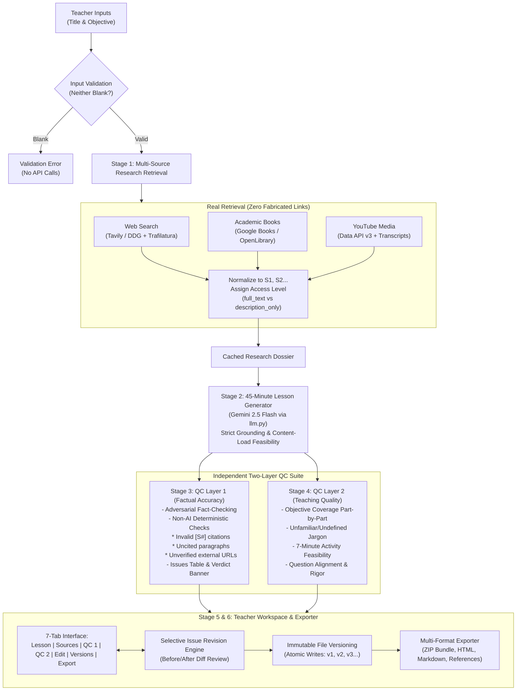

# LessonForge ⚒️
> **Research. Teach. Verify.**  
> Autonomous, Grounded AI Lesson Creation Workstation for Teachers

LessonForge is a local, AI-powered instructional workstation that empowers educators to build comprehensive, verified 45-minute lesson plans for any topic.

Unlike generic chatbot wrappers, LessonForge retrieves **real research** across authoritative websites, academic books, and educational YouTube transcripts, strictly enforces grounding on that research with inline citations, and audits the lesson plan through **two independent automated Quality Control (QC) review layers** before presenting the result in an interactive teacher workspace with immutable versioning and multi-format exports.

---

## 📸 Screenshots & Workflow

```
[ Hero Header: LessonForge — Research. Teach. Verify. ]
[ Step Stepper: (1) Input  ──►  (2) Research  ──►  (3) Lesson  ──►  (4) QC Accuracy  ──►  (5) QC Teaching  ──►  (6) Edit & Export ]

+----------------------------------------------------------------------------------------------------+
| Lesson Tab | Sources (11) | QC 1: Accuracy | QC 2: Teaching | Edit | Versions (v2) | Preview & Export |
+----------------------------------------------------------------------------------------------------+
| ⏱️ Lesson Pacing Timeline: [==== 3m ====][====== 7m ======][==== 10m ====][=== 8m ===][= 5m =][= 7m =][= 5m =] 45/45m |
|                                                                                                    |
| # HTTP Requests and Responses: Methods and Status Codes                                             |
| Every web interaction operates on this client-server contract [S1]...                              |
+----------------------------------------------------------------------------------------------------+
```

---

## 🏗️ System Architecture



---

## ⚡ Quickstart & Setup

### 1. Prerequisites
- Python 3.11+
- Virtual environment tool (`venv`)

### 2. Installation
```powershell
# Clone or navigate to the project directory
cd kalvium

# Create and activate virtual environment
python -m venv .venv
.\.venv\Scripts\activate

# Install pinned dependencies
pip install -r requirements.txt
```

### 3. API Key Configuration
Copy `.env.example` to `.env`:
```powershell
cp .env.example .env
```
Edit `.env` or configure keys directly within the app's sidebar settings panel:

| Variable | Required? | Purpose & How to Obtain |
|---|---|---|
| `GEMINI_API_KEY` | Recommended | Google Gemini LLM API key. Obtain free at [Google AI Studio](https://aistudio.google.com/). If omitted, app operates in offline mock prototype mode. |
| `GEMINI_MODEL` | Optional | Default: `gemini-2.5-flash`. Supports `gemini-2.0-flash`, `gemini-1.5-pro`. |
| `TAVILY_API_KEY` | Optional | Web research with full extracted content. Obtain at [Tavily](https://tavily.com/). If omitted, DuckDuckGo (`ddgs`) + `trafilatura` is used automatically. |
| `GOOGLE_BOOKS_API_KEY` | Optional | Google Books API. Keyless public queries work by default with rate limits; OpenLibrary acts as secondary fallback. |
| `YOUTUBE_API_KEY` | Optional | YouTube Data API v3 key for educational video search. If omitted, DuckDuckGo video search + `youtube-transcript-api` is used. |

### 4. Running the App
```powershell
.\.venv\Scripts\streamlit.exe run app.py
```
Open your browser at `http://localhost:8501`.

---

## 🔄 How the 6 Stages Work

### Stage 1: Inputs & Normalized Research
- **Strict Validation:** Ensures neither `Lesson Title` nor `Learning Objective` is blank before invoking any network API.
- **Demo Pre-loaders:** One-click buttons to load `Test 1: HTTP Protocol` or `Test 2: Python Lists & Tuples`.
- **Multi-Source Retrieval:** Retrieves 4–6 web pages, 2–3 books, and 2–3 YouTube videos.
- **Normalization:** Every source is indexed as `S1`, `S2`, `S3`... with title, author/channel, verified URL, retrieved excerpt, and an explicit **Access Level**:
  - `full_text`: Webpage text or spoken YouTube transcript was fetched.
  - `description_only`: Only book description/preview or video snippet was available. The UI explicitly states: *"Only the description was available. This source was NOT read or watched in full."*
- **Grounded Relevance Note:** A concise note explaining how the source supports the specific lesson objective.

### Stage 2: Grounded 45-Minute Lesson Generation
- Generated strictly from research dossier excerpts.
- Adheres to the exact 45-minute budget:
  1. Introduction (3 min) — real-world hook and framing
  2. Core concept explanation (7 min) — clear explanation with analogies
  3. Key methods/techniques with examples (10 min) — deep dive with code blocks
  4. Categories/second concept (8 min) — taxonomy and comparisons
  5. Selected video segment (5 min) — specific video with timestamps or limitation note
  6. Practical activity (7 min) — step-by-step instructions with teacher worked solution
  7. Questions and recap (5 min) — recap + 5–8 questions covering recall, classification, analysis, and synthesis
- Total budget: **exactly 45 minutes** with an interactive Altair stacked bar visual.
- Per-section content load checks based on ~130 spoken words per minute.
- Auto-built References section citing only sources actually used.

### Stage 3: QC Layer 1 (Factual Accuracy Review)
- Independent adversarial review comparing the lesson text against source excerpts.
- Produces a verdict banner (*"Needs revision"* / *"Looks good"*), confidence note, and audit table.
- **Deterministic (non-AI) Code Checks:**
  - Verifies that every `[S#]` tag exists in the research dossier.
  - Flags uncited technical assertions.
  - Flags any external URL in the text that did not originate from API results.

### Stage 4: QC Layer 2 (Teaching Quality Review)
- Independent pedagogical review assessing:
  - Objective alignment part-by-part.
  - Learner clarity (flagging unfamiliar jargon used before being defined).
  - Activity feasibility (can it be completed in 7 minutes?).
  - Question alignment (does it test application/classification?).
- Generates an **Objective Coverage Table** mapping each objective component to where it is taught and tested.

### Stage 5: Teacher Review, Editing & Revision
- 7-tab interface: `Lesson | Sources | QC 1 | QC 2 | Edit | Versions | Preview & Export`.
- Interactive checkboxes next to QC issues with "Select all" and **"Revise using selected suggestions"**.
- Calls LLM to apply selected fixes, computes an inline before/after diff (`difflib`), and allows the teacher to **Accept** or **Discard**.
- Immutable version history (`v1`, `v2`, `v3`...) with one-click rollback.
- **Atomic File Saves:** Writes to temporary file then atomically renames to guarantee teacher edits are never corrupted or overwritten by failing operations.

### Stage 6: Preview & Multi-Format Downloads
- Print-ready HTML preview with `@media print` typography.
- Downloads:
  - **Single ZIP Bundle:** Contains `lesson.md`, `lesson.html`, `references.md`, `qc_report_1_accuracy.md`, and `qc_report_2_teaching.md`.
  - **Individual Buttons:** Download any file separately.
  - Reports formatted as readable Markdown tables (`Issue found | Suggested improvement | Severity | Status: applied/pending`).

---

## 🛡️ Error-Handling Matrix (Demonstrable in Demo)

| Situation | System Behavior |
|---|---|
| Blank input | Displays clear red error (e.g. *"Learning Objective is required"*), zero API calls made. |
| Research failure | Displays real error, shows "Retry research" button, preserves user inputs. |
| Partial research failure | Shows available sources with a yellow warning badge for missing channel (e.g. YouTube quota). |
| AI generation failure | Displays error, provides "Retry generation" without re-fetching research. |
| QC step failure | "Retry QC 1" or "Retry QC 2" retries only the affected review without touching the lesson. |
| Teacher saves edit, later step fails | Teacher's saved work is 100% preserved; atomic file replacement prevents corruption. |
| Malformed LLM JSON | Auto-repair attempts syntax correction up to 2 times before showing a friendly message. |
| Rate limit / timeout | Exponential backoff (2s, 4s, 8s) before reporting clean error. |
| **Developer Mode Simulation** | Hidden sidebar dropdown allows toggling simulated failures for demo recordings. |

---

## 🎤 How I'd Explain This in My Demo (Talking Points)

1. **The Core Problem:** Most AI tools create generic, ungrounded slide decks or hallucinate facts and links. Teachers cannot trust an AI that makes up historical dates or programming syntax.
2. **The Grounding Principle:** LessonForge never lets the LLM invent URLs. We pull real documentation from MDN, official Python docs, academic books via Google Books / OpenLibrary, and real transcripts via `youtube-transcript-api`. If we only got a book's description, the UI tells the teacher honestly: *"Only the description was available. This source was NOT read in full."*
3. **The 45-Minute Lesson Architecture:** Classroom periods are finite. We enforce a strict 45-minute budget divided into 7 purposeful phases—from the 3-minute inquiry hook to the 7-minute diagnostic lab with worked solutions and exit ticket questions.
4. **The Dual QC Firewalls:**
   - *QC Layer 1 (Fact-Checker):* Adversarially cross-checks claims against source excerpts, backed by deterministic Python checks that verify citation IDs and ban fabricated links.
   - *QC Layer 2 (Instructional Coach):* Checks objective coverage part-by-part, catches technical jargon introduced without definitions, and ensures the 7-minute activity is realistic.
5. **Teacher in the Driver's Seat:** The teacher selects which QC suggestions to apply. The AI generates a clean revision, displays a visual before/after diff, and requires teacher confirmation. Every change is preserved in local immutable version snapshots with instant rollback.
6. **Zero Vendor Lock-In:** Local JSON/Markdown files, in-memory ZIP generation, and print-ready HTML exports.

---

## ⚠️ Known Limitations

1. **Keyless Google Books Rate Limits:** The keyless Google Books API endpoint frequently returns HTTP 429 when queried from shared IP ranges. LessonForge automatically handles this by falling back to the unmetered OpenLibrary API.
2. **YouTube Videos Without Closed Captions:** If a video creator disables captions, spoken transcripts cannot be parsed; LessonForge marks the source as `description_only` and alerts the teacher.
3. **Offline Prototype Mode:** When no Gemini API key is configured, LessonForge uses deterministic fallback responses for local testing.

---

## 🧪 Running the Unit Tests

Execute the automated pytest suite:
```powershell
.\.venv\Scripts\pytest.exe -v tests/test_lessonforge.py
```
Outputs: 9 passed in ~1.9s.
# teaching-module

