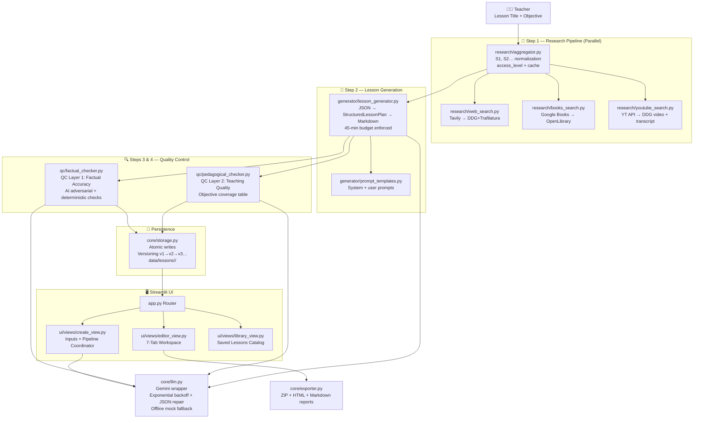

<div align="center">


# ⚒️ LessonForge
### *Autonomous AI Lesson Creation Suite for Teachers*

> **Research. Teach. Verify.** — Build grounded, QC-reviewed 45-minute lesson plans powered by real web, book, and YouTube research.

<br/>

[](https://python.org)
[](https://streamlit.io)
[](https://aistudio.google.com)
[](LICENSE)
[](tests/)
[](README.md)

<br/>

[🚀 Quick Start](#-quick-start) · [✨ Features](#-features) · [🏗️ Architecture](#️-architecture) · [📋 Project Structure](#-project-structure) · [🔑 API Keys](#-api-keys) · [🧪 Testing](#-testing)

</div>

---

## 🎯 What is LessonForge?

LessonForge is a **fully local, AI-powered lesson creation tool** built for teachers. Unlike tools that generate generic content from thin air, LessonForge first **researches the topic by actually retrieving information** from real websites, books, and YouTube videos — then uses only that verified research to write a complete, grounded 45-minute classroom lesson.

Every lesson goes through **two independent AI quality control layers** — one for factual accuracy, one for pedagogical quality — before the teacher ever reads it. Teachers can then edit, revise using selected QC suggestions, version-control their work, preview, and export everything as a professional ZIP bundle.

```
Teacher enters topic → Real research retrieved → Lesson grounded in sources
                     → QC Layer 1: Fact check → QC Layer 2: Teaching quality
                     → Edit, diff, version → Export ZIP
```

---

## ✨ Features

### 🔬 Step 1 — Grounded Research Pipeline
- Retrieves **4–6 web pages**, **2–3 books**, and **2–3 YouTube videos** in parallel
- **Tavily Search API** (primary) or **DuckDuckGo + Trafilatura** (automatic fallback) for web pages with full content extraction
- **Google Books API** or **OpenLibrary** (fallback) for academic book descriptions
- **YouTube Data API v3** or **DDG video search** (fallback) with real transcript fetching via `youtube-transcript-api`
- Every source is normalized to a `S1, S2...` ID scheme with an `access_level` badge:
  - ✅ **Full Text Verified** — page/transcript was actually read
  - ⚠️ **Description Only** — only metadata/snippet was available (clearly disclosed to teacher)
- **LLM never generates URLs.** All links come from API results only.
- Research is cached per session — retrying generation never re-fetches sources

### 📝 Step 2 — Structured 45-Minute Lesson Generation
- Generates a **strict JSON lesson plan**, validated and normalized, then rendered to rich Markdown
- Exact 45-minute budget enforced across 7 required sections:

| Section | Minutes |
|---|---|
| Introduction (hook) | 3 |
| Core concept explanation | 7 |
| Key methods / techniques with examples | 10 |
| Categories / second concept | 8 |
| Selected video segment (with timestamps if transcript exists) | 5 |
| Practical activity (step-by-step + worked solution) | 7 |
| Comprehension questions & recap | 5 |
| **Total** | **45** |

- Inline citations `[S1]`, `[S3]` on every factual claim, auto-built References section
- **Timing feasibility indicator** per section (word-count vs. 130 words/minute baseline)
- **Altair stacked bar chart** showing the full 45-minute split at a glance

### 🔍 Step 3 — QC Layer 1: Factual Accuracy Review
- Independent AI adversarial review against retrieved source excerpts
- Checks: statement correctness, citation support, source reliability, contradictions, uncited claims
- **Deterministic Python checks** (no AI): invalid `[S#]` IDs, uncited technical paragraphs, hallucinated URLs
- Output: structured issue list with `severity` (high/medium/low), `location`, `evidence`, `suggested_improvement`
- Verdict, confidence note, and what-was-verified explanation included

### 🎓 Step 4 — QC Layer 2: Teaching Quality Review
- Completely independent AI reviewer (different prompt, different report)
- Checks: objective coverage part-by-part, clarity for learners, jargon before definition, activity feasibility, question alignment, 45-minute pacing
- **Objective coverage table**: each part of the learning objective → where taught → where tested → covered ✓/✗
- Same structured issue JSON format as QC 1

### ✏️ Step 5 — 7-Tab Teacher Workspace
| Tab | What's Inside |
|---|---|
| **Lesson** | Rendered Markdown + Altair timing chart |
| **Sources** | Research cards with type icon, access badge, relevance note, clickable link |
| **QC 1: Accuracy** | Verdict banner, issue cards with checkboxes, Retry button |
| **QC 2: Teaching** | Objective coverage table, issue cards, Retry button |
| **Edit** | Full Markdown text area, save version |
| **Versions** | Full version history (v1, v2 …) with timestamps, notes, one-click restore |
| **Preview & Export** | Live HTML preview + 5 download buttons + full ZIP bundle |

- **Checkbox-driven revision:** Select specific QC issues → "Revise using selected suggestions" → LLM applies only those fixes
- **Before/After diff viewer** (`difflib`) — accept or discard every AI revision
- **Atomic disk writes** (temp file → `os.replace()`) — teacher edits are **never** overwritten by a failing operation
- QC reports are automatically marked **stale** after any revision, with a prompt to re-run

### 📦 Step 6 — Export Bundle
ZIP archive contains:
```
lesson.md                 ← Full lesson in Markdown
lesson.html               ← Styled HTML with print CSS (ready to photocopy)
references.md             ← Auto-built references table
qc_report_1_accuracy.md  ← Factual QC report as readable table
qc_report_2_teaching.md  ← Pedagogical QC report as readable table
```
Plus individual download buttons for each file.

---

## 🏗️ Architecture



---

## 📋 Project Structure

```
lessonforge/
│
├── app.py                        # Streamlit entry point & router
├── config.py                     # Centralised config from .env
├── requirements.txt              # Pinned dependencies
├── .env.example                  # Secret placeholders (commit this)
├── .env                          # Your real keys (never commit)
├── run.bat                       # Windows one-click launcher
├── run.ps1                       # PowerShell launcher
├── repair_lessons.py             # One-time fix for corrupted lesson files
│
├── core/
│   ├── llm.py                    # Gemini wrapper (backoff, JSON repair, offline mock)
│   ├── models.py                 # All Pydantic schemas
│   ├── storage.py                # Atomic file I/O + versioning
│   └── exporter.py               # ZIP builder, HTML renderer, report formatter
│
├── research/
│   ├── aggregator.py             # Parallel retrieval, S# normalization, cache
│   ├── web_search.py             # Tavily → DuckDuckGo + Trafilatura fallback
│   ├── books_search.py           # Google Books → OpenLibrary fallback
│   └── youtube_search.py         # YouTube API → DDG video + transcript fallback
│
├── generator/
│   ├── lesson_generator.py       # JSON lesson plan → Markdown renderer
│   └── prompt_templates.py       # All LLM system + user prompts
│
├── qc/
│   ├── factual_checker.py        # QC Layer 1: AI + deterministic accuracy checks
│   └── pedagogical_checker.py    # QC Layer 2: Teaching quality & objective coverage
│
├── ui/
│   ├── styles.py                 # Full SaaS CSS injection
│   ├── components.py             # Hero header, stepper, Altair chart, diff viewer
│   └── views/
│       ├── create_view.py        # Step 1–5 pipeline coordinator
│       ├── editor_view.py        # 7-tab lesson workspace
│       └── library_view.py       # Saved lessons catalog
│
├── tests/
│   └── test_lessonforge.py       # 9 pytest unit tests
│
├── data/
│   └── lessons/                  # Auto-created lesson storage
│       └── <lesson-id>/
│           ├── metadata.json
│           ├── lesson.md         # Active version
│           ├── research.json
│           ├── qc_factual.json
│           ├── qc_pedagogical.json
│           └── versions/
│               ├── history.json
│               ├── v1.md
│               └── v2.md …
│
└── sample_outputs/               # Pre-generated demo exports
```

---

## 🚀 Quick Start

### Prerequisites
- Python **3.11+** ([download](https://python.org/downloads))
- A **Google Gemini API key** ([get one free](https://aistudio.google.com/)) — required for live AI generation

### 1 — Clone the repo
```bash
git clone https://github.com/praneeshkumar4-eng/teaching-module.git
cd teaching-module
```

### 2 — Create a virtual environment
```bash
# Windows
python -m venv .venv
.\.venv\Scripts\activate

# macOS / Linux
python3 -m venv .venv
source .venv/bin/activate
```

### 3 — Install dependencies
```bash
pip install -r requirements.txt
```

### 4 — Configure secrets
```bash
# Copy the example file
cp .env.example .env
```

Open `.env` and fill in your keys:
```env
GEMINI_API_KEY=your_gemini_api_key_here
GEMINI_MODEL=gemini-2.5-flash

# Optional — app works without these using free fallbacks
TAVILY_API_KEY=
GOOGLE_BOOKS_API_KEY=
YOUTUBE_API_KEY=
```

### 5 — Launch the app
```bash
# Option A: One-click launcher (Windows)
run.bat

# Option B: Direct command
.\.venv\Scripts\streamlit.exe run app.py

# Option C: PowerShell (after enabling script execution)
.\run.ps1
```

The app opens at **http://localhost:8501** 🎉

> **No API key?** LessonForge runs in **Offline Prototype Mode** — all UI features, navigation, versioning, and export work immediately with structured demo content.

---

## 🔑 API Keys

| Key | Required? | Purpose | Free Tier? | Get it |
|---|---|---|---|---|
| `GEMINI_API_KEY` | ✅ Required | AI lesson generation, QC layers, revision | Yes | [aistudio.google.com](https://aistudio.google.com) |
| `TAVILY_API_KEY` | Optional | Enhanced web research with full page extracts | Yes (1000 req/month) | [tavily.com](https://tavily.com) |
| `GOOGLE_BOOKS_API_KEY` | Optional | Higher rate limits on book search | Yes | [console.cloud.google.com](https://console.cloud.google.com) |
| `YOUTUBE_API_KEY` | Optional | YouTube Data API v3 video search | Yes (10,000 units/day) | [console.cloud.google.com](https://console.cloud.google.com) |

> All keys can also be entered at runtime from the **⚙️ API Keys & AI Settings** panel in the app sidebar — no restart needed.

---

## 🧪 Testing

Run the full test suite:
```bash
.\.venv\Scripts\python.exe -m pytest tests/test_lessonforge.py -v
```

**9 tests covering:**

| Test | What it verifies |
|---|---|
| `test_input_validation` | Blank fields are caught and named precisely |
| `test_citation_checker_valid` | Valid `[S1]`, `[S2]` citations pass deterministic checks |
| `test_citation_checker_catches_invalid_ids` | `[S99]` flagged when only S1/S2 exist |
| `test_citation_checker_catches_unverified_urls` | Hallucinated URLs not in research are flagged |
| `test_atomic_write` | Temp-file-then-rename atomic write works correctly |
| `test_storage_lifecycle_and_rollback` | Save → v2 → rollback to v1 lifecycle |
| `test_lesson_timing_budget_sums_to_45` | Generated lesson is exactly 45 minutes |
| `test_exporter_bundle_contents` | ZIP contains all 5 required files |
| `test_failure_simulation_hooks` | Research/QC1/QC2 failure toggles raise expected errors |

Expected output:
```
9 passed in ~2s
```

---

## ⚠️ Error Handling

Every failure mode is handled gracefully with a targeted retry button:

| Situation | Behavior |
|---|---|
| Blank input | Names the specific missing field — no API call made |
| Research fails | Shows real error + **Retry Research** button, keeps inputs |
| Partial research (e.g. YouTube fails) | Shows warning badge on missing type, continues with available sources |
| AI generation fails | Shows error + **Retry Generation** button — research is not re-fetched |
| QC Layer 1 fails | **Retry QC 1** button only — lesson is not regenerated |
| QC Layer 2 fails | **Retry QC 2** button only — lesson is not regenerated |
| Teacher saved edits + step fails | Saved work is never touched; atomic writes guarantee integrity |
| Malformed LLM JSON | Auto-repair attempted twice before surfacing error to teacher |

> **Developer Mode** — The sidebar includes a failure simulation dropdown to demonstrate every error scenario for demos and testing.

---

## 🖥️ UI Tour

```
┌─────────────────────────────────────────────────────────────────┐
│  ⚒️ LessonForge                                   [Sidebar]     │
│  Research. Teach. Verify. — Autonomous AI Lesson Creation Suite │
├─────────────────────────────────────────────────────────────────┤
│  ① Input ──✓── ② Research ──✓── ③ Lesson ──✓──                 │
│  ④ QC Accuracy ──✓── ⑤ QC Teaching ──● ⑥ Edit & Export        │
├─────────────────────────────────────────────────────────────────┤
│                                                                 │
│  Lesson │ Sources (11) │ QC 1: Accuracy │ QC 2: Teaching       │
│  Edit   │ Versions (v5) │ Preview & Export                     │
│                                                                 │
│  ⏱️ Lesson Pacing Timeline ─────────────── 45 / 45 Min         │
│  [████Intro████][████Core████][████████Methods████████]...     │
│                                                                 │
│  ## Introduction (3 min)                                        │
│  Imagine ordering a meal at a restaurant...                     │
│                                                                 │
└─────────────────────────────────────────────────────────────────┘
```

---

## 🔄 Lesson Generation Pipeline

```
Teacher Input
    │
    ▼
┌─────────────────────────────────────────────────────┐
│  RESEARCH  (concurrent — 3 threads)                  │
│  Web: Tavily / DDG+Trafilatura  → full_text          │
│  Books: Google Books / OpenLibrary → description     │
│  YouTube: YT API / DDG → transcript or description   │
│  Normalize → S1, S2 … Sn  +  relevance notes        │
└───────────────────┬─────────────────────────────────┘
                    │  ResearchDossier
                    ▼
┌─────────────────────────────────────────────────────┐
│  GENERATION  (Gemini / offline mock)                 │
│  Prompt = system + user + full research context      │
│  Response: JSON → StructuredLessonPlan               │
│  Normalize 7 sections, enforce 45 min, render MD     │
└───────────────────┬─────────────────────────────────┘
                    │  lesson.md
          ┌─────────┴──────────┐
          ▼                    ▼
┌─────────────────┐  ┌─────────────────────────────┐
│  QC Layer 1     │  │  QC Layer 2                  │
│  Factual Audit  │  │  Pedagogical Audit           │
│  AI + Python    │  │  Objective Coverage Table    │
│  deterministic  │  │  Pacing, Jargon, Questions   │
└────────┬────────┘  └───────────┬─────────────────┘
         └──────────┬────────────┘
                    ▼
         ┌────────────────────┐
         │  LessonPackage     │
         │  Atomic disk save  │
         │  data/lessons/<id> │
         └────────────────────┘
```

---

## 🛠️ Tech Stack

| Layer | Technology |
|---|---|
| **UI** | [Streamlit](https://streamlit.io) with custom SaaS CSS, Altair charts |
| **AI** | [Google Gemini](https://aistudio.google.com) via `google-genai` SDK (`gemini-2.5-flash`) |
| **Web research** | [Tavily](https://tavily.com) → [DuckDuckGo](https://duckduckgo.com) + [Trafilatura](https://trafilatura.readthedocs.io) |
| **Book research** | [Google Books API](https://developers.google.com/books) → [OpenLibrary](https://openlibrary.org/developers/api) |
| **Video research** | [YouTube Data API v3](https://developers.google.com/youtube) → `youtube-transcript-api` |
| **Data models** | [Pydantic v2](https://docs.pydantic.dev) |
| **Visualisation** | [Altair](https://altair-viz.github.io) stacked bar charts |
| **Storage** | Local JSON + Markdown under `data/lessons/` — no database |
| **Diffs** | Python standard library `difflib` |
| **Export** | `zipfile` (in-memory ZIP), `markdown` (HTML render) |
| **Testing** | [pytest](https://pytest.org) |

---

## 📌 Key Design Decisions

| Decision | Rationale |
|---|---|
| **All LLM calls go through `core/llm.py`** | Single swap point to change AI provider |
| **Atomic writes everywhere** | `tempfile → os.replace()` — teacher edits survive any crash |
| **Research cached in memory** | Retrying generation never wastes API quota re-fetching sources |
| **LLM never generates URLs** | All URLs come from API results only — prevents hallucination |
| **QC layers are independent** | Different prompts, different data structures, different retry buttons |
| **Offline prototype mode** | Full demo without any API key; structured mock returns real lesson content |
| **access_level badges mandatory** | Teachers always know if a source was read in full or only described |

---

## 📄 License

MIT License — free to use, modify, and distribute.

---

<div align="center">

Built with ❤️ for teachers · Powered by [Google Gemini](https://deepmind.google/technologies/gemini/) · UI by [Streamlit](https://streamlit.io)

**[⬆ Back to top](#️-lessonforge)**

</div>
